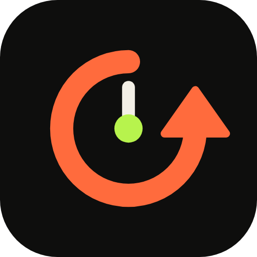
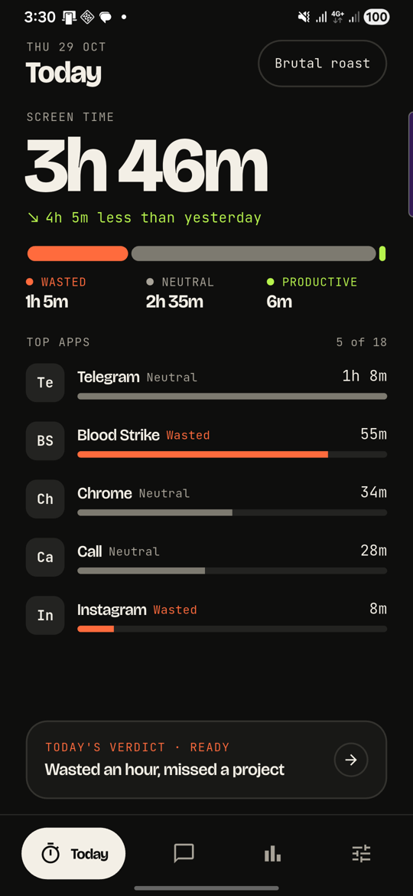
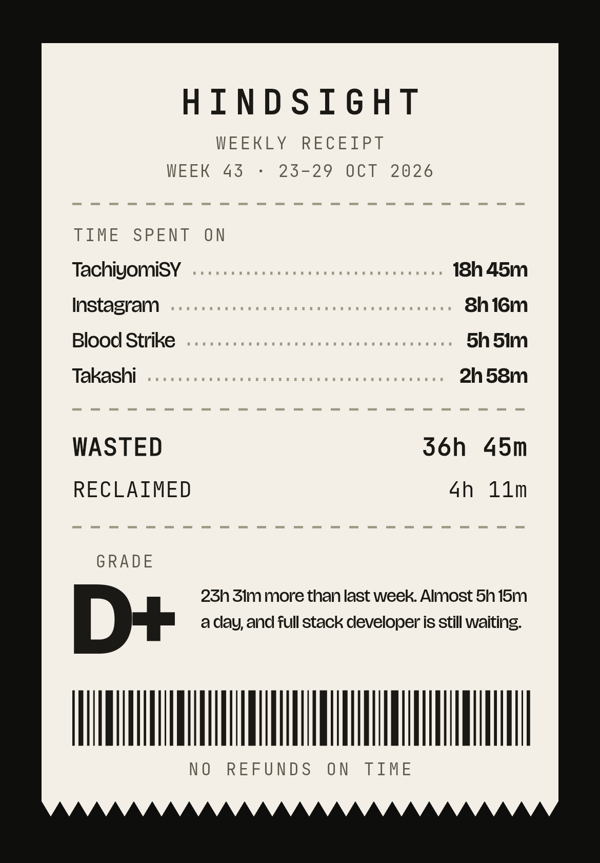

# Hindsight



Screen time, judged. Hindsight reads how long you actually spent in each app
today, sorts it into wasted / neutral / productive against the goal you named in
onboarding, and tells you what that time could have been instead.

An Android app, built with Flutter. All the numbers are computed on your phone;
the optional verdict writer is the only thing that talks to the internet.

## Download

**[Download the latest APK →](../../releases/latest)**

| File | Size | Use it for |
| --- | --- | --- |
| `hindsight-*-universal.apk` | ~14 MB | Any Android phone (recommended) |
| `hindsight-*-arm64-v8a.apk` | ~8 MB | Most phones from ~2018 onwards (smaller download) |
| `hindsight-*-armeabi-v7a.apk` | ~8 MB | Older 32-bit phones |

Android 7.0 (API 24) or newer. This is a side-loaded APK, not a Play Store
listing: open the file on the phone and allow "install unknown apps" for your
browser or file manager when Android asks.

After installing, Hindsight opens Android's **Usage access** screen. Turn it on
for Hindsight, come back, and the app fills in with real screen time. Until then
it runs on demo data so you can look around.

<p>
  
  
</p>

## What's in the app

| Screen | File | What it does |
| --- | --- | --- |
| Onboarding | `lib/screens/onboarding.dart` | Six steps: hook, goal, tone of voice, usage access, daily limit, ready |
| Today | `lib/screens/today.dart` | Today's total, the one-line verdict, top apps with per-app tags |
| Verdict | `lib/screens/verdict.dart` | The full daily verdict in the voice you picked, plus what the wasted time could have bought |
| Receipt | `lib/screens/receipt.dart` | The weekly receipt, drawn with painters, shared as a PNG image |
| History | `lib/screens/history.dart` | 7/30 day bars, best/worst day, week-over-week |
| App detail | `lib/screens/app_detail.dart` | One app: when you open it, total time, tag it wasted/neutral/productive |
| Settings | `lib/screens/settings_screen.dart` | Voice, goal, limit, verdict writer (`api_key.dart`), prompt editor (`prompt.dart`), tag editor (`classify.dart`), reminders, delete all data |

### The launch animation

`lib/widgets/hindsight_launch.dart` draws the Rewind mark with a `CustomPainter`
and plays a 2-second one-shot cold-start animation: the ring draws itself, the
clock hand rewinds with trailing ghosts, the name wipes in, and the loading line
fills. Tap to skip. `LaunchGate` holds the last frame until `AppState.init()`
finishes, so the home screen never appears half-loaded, then cross-fades in.
It honours the OS "remove animations" setting.

### Sharing

"Share receipt" renders the receipt offscreen at a fixed 390 pt width, captures
it at 3× (1170 px wide) and shares a real `image/png`, so Telegram, WhatsApp and
the rest show the receipt itself instead of a text dump. `renderReceiptPng` in
`lib/screens/receipt.dart` does the offscreen capture.

### The verdict writer

Settings → Verdict writer supports **Groq, OpenAI, Anthropic, Google Gemini,
OpenRouter**, plus any **OpenAI-compatible** server (Ollama, LM Studio, vLLM:
base URL + model). Keys, model choices and base URLs are stored per provider, so
switching never loses one. Model lists are fetched with the key, so the picker
only offers models that key can actually call.

The AI only writes the words. The wasted/neutral/productive split, the totals,
the daily limit and the milestone maths are computed on the phone and passed to
the model as fixed facts; a custom prompt cannot invent numbers or break the
JSON. Without a key — or when the request fails — `lib/ai/local_verdict.dart`
writes the verdict offline in the same voice.

## Code map

- `lib/store.dart` — `AppState` (ChangeNotifier): settings, usage, verdict cache
  (one per day), reminders, and the home-widget snapshot, persisted in
  `SharedPreferences`.
- `lib/data/usage_repository.dart` — the only place that talks to the platform.
  On Android it calls the `hindsight/usage` method channel; anywhere else, or
  without usage access, it falls back to `lib/data/sample_usage.dart` so the app
  is fully usable on desktop and a fresh emulator.
- `lib/ai/verdict_service.dart` + `lib/ai/providers.dart` — one request/response
  shape per provider, shared prompt and JSON parsing.
- `lib/ai/milestones.dart` — what the weekly wasted time would buy towards the
  goal, in weeks and months.
- `lib/widgets/home_widgets.dart` — pushes a JSON snapshot of today to the native
  widget providers over `hindsight/widgets`.
- `android/app/src/main/kotlin/.../HomeWidgets.kt` — the five launcher widgets
  and their chart bitmaps (ring, split bar, limit bar, week bars).
- `android/app/src/main/kotlin/.../MainActivity.kt` — the Kotlin bridge over
  `UsageStatsManager`: `hasAccess`, `openAccessSettings`, `queryUsage` (per-day,
  per-app minutes for N days, plus open counts and hourly buckets).
- `android/app/src/main/kotlin/.../Reminders.kt` — the 22:00 verdict
  notification: alarm scheduling, reboot re-arming and the exact-alarm check.

## Icon and widgets

The launcher icon is the "Rewind" mark on `#0E0E0D`. `tool/render_icon.py`
rasterises the SVG with headless Chrome into every density, the adaptive-icon
foreground (108 dp, art inside the 72 dp safe zone), the launch-screen mark and
a 512 px listing icon. It also writes `design/icon/contact-sheet.png` for
eyeballing. The launch window and the in-app splash both use it, so there is no
default Flutter logo and no white frame on start.

Five home-screen widgets:

| Widget | Size | Shows |
| --- | --- | --- |
| Ring | 2x2 | Wasted today around a limit ring, over/under in words |
| Verdict | 2x2 | Today's one-liner and the voice it was written in |
| Limit | 4x1 | Wasted against the limit, with the limit marker |
| Today | 4x2 | Screen time, delta vs yesterday, top three apps, split bar |
| Week | 4x4 | Seven days of wasted time, limit line, verdict teaser |

Dart cannot run inside a widget, so `AppState` writes a snapshot (today's
numbers, the week, the top apps, the verdict line) over the channel and the
providers redraw. Tapping any widget opens the app.

## Permissions

`PACKAGE_USAGE_STATS` is a *special* access, not a runtime permission. The app
opens the right settings page itself and falls back to demo data until the
toggle is on.

`QUERY_ALL_PACKAGES` is declared because Android 11+ hides other apps by
default: without it every app name in the usage data degrades to the package
suffix (`com.instagram.android` showed up as "Android", `eu.kanade.tachiyomi.sy`
as "Sy") and the per-app usage *events* — opens and the hourly chart — come back
empty. A screen-time app has to see the whole device to do its job.

`SCHEDULE_EXACT_ALARM` is optional: it lets the 22:00 reminder land on the
minute instead of inside Android's ten-minute batch window. Settings shows the
row that grants it only while it is missing.

## Building

Requires Flutter 3.35+ and an Android SDK.

```bash
flutter pub get
flutter run
flutter build apk --release --split-per-abi --split-debug-info=build/symbols
```

`--split-per-abi` produces one APK per CPU (arm64 ≈ 8 MB). For one APK that
covers every phone:

```bash
flutter build apk --release --target-platform android-arm,android-arm64 \
  --split-debug-info=build/symbols     # ≈ 14 MB
```

Native libraries are stored compressed (`useLegacyPackaging` in
`android/app/build.gradle.kts`), which cuts the download by about 40%; Android
unpacks them on install. `--split-debug-info` strips symbols from the APK; keep
the `build/symbols` folder if you want readable release stack traces.

### Signing

Releases are signed with a private keystore, referenced from
`android/key.properties` (both git-ignored). A clone without them still builds:
release falls back to the debug key. **Keep the keystore and its passwords
safe** — Android will not install an update signed with a different key, so
losing them means every user has to uninstall and reinstall.

## Tests

```bash
flutter analyze   # no issues
flutter test      # 37 passing
```

Widget tests render every tab, onboarding, settings, the verdict writer, the
prompt editor and the first-use tips at 390×844 with the real fonts, failing on
overflow. They also cover the launch animation (play, skip, reduced motion,
holding for the app to boot), the receipt PNG capture (3× size, full height,
nothing left on screen), per-provider AI keys and migration, Anthropic/Gemini
request shapes, per-app tag changes and exact-alarm hints. `test/verdict_test.dart`
pins the sample dataset to the design day (6h 12m total, 4h 33m wasted, grade
D+ for the week).
